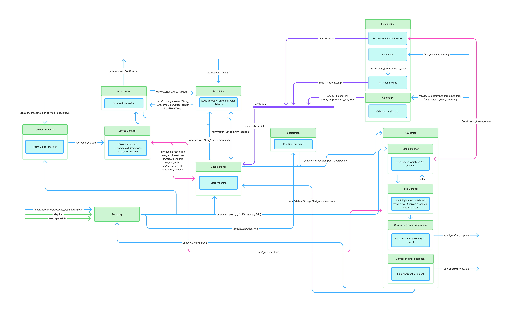

# Autonomous Mobile Manipulation Robot

**KTH DD2419 Project Course · Group 3**

This ROS 2 project implements an autonomous mobile robot that explores a bounded indoor workspace, finds cubes and drop boxes, picks cubes up with a small arm, and carries them to a box. The robot starts with a workspace polygon and a partial map; LiDAR and RGB-D observations are used to build a more complete picture while it moves.

## Final run

The supplied demonstration is included at 2× speed (about 2 min 20 sec; the original is about 4 min 40 sec). The player below is supported by many Markdown hosts; if it does not appear in your viewer, use the download link.

<video controls width="800" poster="media/video/performance-preview.jpg">
  <source src="media/video/final_result_ms3_2x.mp4" type="video/mp4">
  Your browser does not support embedded video. [Download the video](media/video/final_result_ms3_2x.mp4).
</video>

[Download the 2× performance video](media/video/final_result_ms3_2x.mp4)

## System design

The system is split into ROS 2 nodes for sensing, mapping, localization, detection, navigation, task coordination, and arm control. The diagram below is the system architecture overview.




## The task

The course task is to collect cube objects of different colors and place them into rectangular boxes. The robot is given a start pose, a workspace polygon, and a partial object/box map. It must discover additional items from onboard sensors, stay inside the workspace geofence, and produce an accumulated map of the objects and boxes it observed. The course limit is 300 seconds, and the task is intended to run onboard without touching the environment during the run.

## How the solution works

1. **Load the workspace and starting map.** The workspace loader reads CSV inputs and publishes the polygon and initial start/object/box transforms. Workspace and map values come from those files rather than being embedded in the task logic.
2. **Estimate motion and map the room.** Wheel encoder and IMU measurements feed odometry. LiDAR scan processing and ICP-based localization reduce pose drift. The mapping node integrates scans into an occupancy grid and marks space outside the workspace as unavailable.
3. **Explore and detect objects.** The goal manager chooses exploration waypoints from the exploration grid, with workspace-constrained waypoint sampling as a fallback. The RealSense detection pipeline filters point clouds by range and height, applies color thresholds in Oklab space, clusters candidates with DBSCAN, and checks detections against the occupancy map. The object manager merges repeat detections and tracks known cubes and boxes.
4. **Plan and navigate.** The goal manager selects a known cube, sends a navigation goal, and asks for a coarse approach followed by a final approach. The global planner uses weighted A* on an inflated occupancy grid and treats other cubes as obstacles. The controller tracks the path with Pure Pursuit and produces differential-drive motor commands.
5. **Pick, deliver, and continue.** The arm vision and control nodes align the gripper to a cube, attempt a pickup, and then place a carried cube in a box. The goal manager handles pickup/drop results and resumes exploration or selects another target. A limited recovery path includes a backup/retry and a snowplow maneuver if a cube remains out of reach.
6. **Write the accumulated object map.** The object manager periodically writes the known objects and boxes to `src/output_map.csv`, using their first observed positions so later contact or movement does not replace the original estimate.

The top-level coordination state machine includes initialization, search/exploration, coarse and final object approach, pickup, coarse and final box approach, drop, and recovery states. The RViz/ROS topics and node logs expose goals, paths, maps, detections, state changes, and arm results so the run can be followed while it operates.

## Main packages

| Package | Role |
| --- | --- |
| `mapping` | Loads workspace and initial map CSVs; builds occupancy and exploration grids from LiDAR. |
| `localization`, `odometry` | Estimate the robot pose using encoders, IMU, scan filtering, and ICP correction. |
| `detection` | Detect cubes and boxes from RealSense point clouds; merge and manage object records; export the map. |
| `goal_manager` | Coordinate exploration, navigation, pickup/drop, and recovery in the task state machine. |
| `global_planner`, `controller` | Plan collision-aware paths and track them with the mobile base. |
| `arm_control`, `robp_arm` | Control the arm and gripper; use camera feedback during manipulation. |
| `robp_launch`, `robp_interfaces` | Hardware/system launch files and ROS messages/services shared by the nodes. |

More detailed notes are in [`documentation/`](documentation/), including the [planner](documentation/milestone1/global_planner.md), [controller](documentation/milestone1/controller.md), [goal manager](documentation/milestone1/goal_manager.md), and [detection](documentation/milestone1/obj_detection.md) documentation.

## Running on the robot

The workspace uses Pixi and ROS 2 Jazzy. The full launch file starts the hardware drivers, sensors, odometry, localization, mapping, detection, planner, controller, and arm nodes. The goal manager is started separately.

```bash
pixi install
pixi run full_system_launch
```

In a second terminal, from the workspace root:

```bash
pixi run goal_manager
```

The launch configuration currently defaults to `src/mapping/config/final_workspace4.csv` and `src/mapping/config/final_map4.csv`. Replace these with the provided workspace and map CSVs for the run. This is a hardware launch, not a simulator launch; see [`documentation/setup/setup.md`](documentation/setup/setup.md) for robot/network setup notes.

## Map output

The object manager writes `src/output_map.csv` every 15 seconds while the goal manager is running. Its CSV rows have `Type,x,y,angle` columns: `O` for a cube and `B` for a box. The current exporter records the first detected/preloaded object position, with x and y in centimeters and angle in degrees. The supplied start pose remains in the input map; this export currently contains object and box rows.

## Repository contents

- `src/` — ROS 2 packages and vendor drivers.
- `documentation/` — subsystem notes and setup instructions.
- `PlatformIO/` — microcontroller firmware project.
- `media/` — system architecture diagram and final run video.
